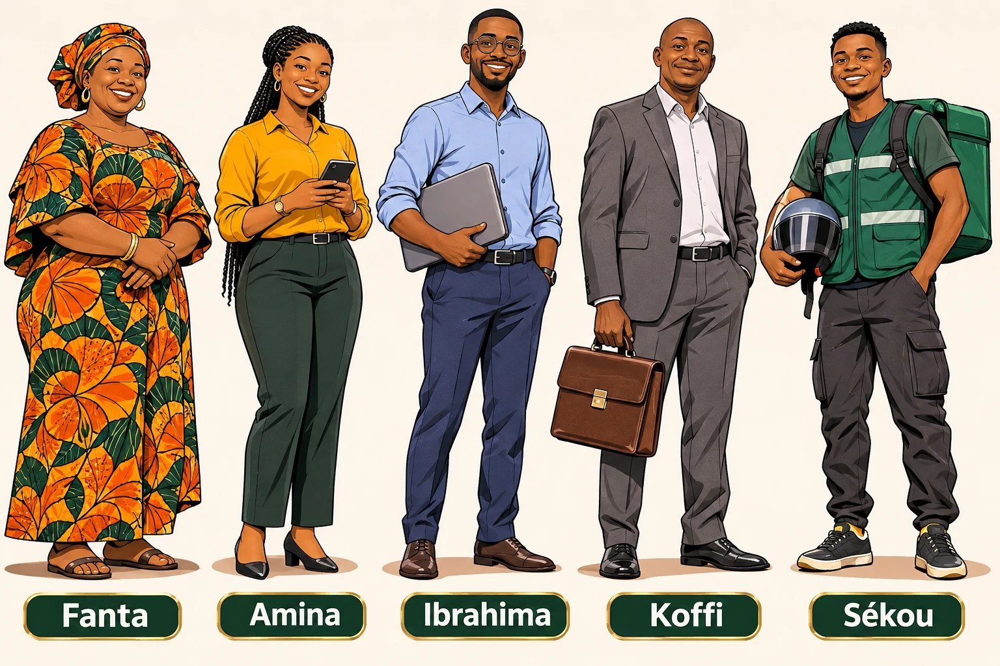

# Avant de commencer : parlons de toi

Bonjour, et bienvenue. Avant tout, une seule question : **pourquoi tu as ouvert ce livre ?**

Je vais deviner. Tu vends quelque chose : des habits, des chaussures, des téléphones, des produits de beauté, une formation en ligne, un service… Ou bien c'est toi qui **livres** ce que les autres vendent. Et il t'arrive des choses qui font mal, presque tous les jours. **Coche tout ce qui t'est déjà arrivé.**

### 💬 Ça t'est déjà arrivé ?

**Quand le client est devant toi**

- ☐ Il touche ta marchandise, demande le prix… et s'en va sans un mot.
- ☐ Tu donnes ton prix, et il propose aussitôt la moitié : « Laisse à… ».
- ☐ Il dit « C'est cher », tu baisses ton prix… et il part quand même.
- ☐ « Je vais faire le tour, je reviens »… et tu ne le revois jamais.
- ☐ « Je dois d'abord montrer à mon mari. »
- ☐ « Écris-le dans le cahier »… et il ne revient jamais payer.

**Quand le client t'écrit (WhatsApp, Facebook, Instagram, TikTok)**

- ☐ « C'est combien ? » Tu réponds. Deux coches bleues… et plus rien.
- ☐ Tu réponds à toutes ses questions, tu envoies des vidéos… et il disparaît.
- ☐ « C'est pas l'arnaque ? », « Vous êtes où ? », « Je paie seulement à la livraison. »
- ☐ « Emballe, je prends ! »… puis le lendemain : **« Finalement, j'annule. »**

**Quand le colis est en route**

- ☐ Le colis est parti… et en pleine route, le client écrit : « C'est annulé. »
- ☐ Le livreur arrive, et le client ne décroche plus.
- ☐ À la porte : « Repasse demain », « Ce n'est pas la couleur », « J'ai vu moins cher ».

**Quand tu vends un produit digital ou à des entreprises**

- ☐ « C'est encore une arnaque comme les autres ? », « Tu as le PDF gratuit ? »
- ☐ Le client clique pour payer… puis abandonne au moment du paiement.
- ☐ « Envoyez-moi un devis »… et plus jamais de nouvelles.

**Si tu as coché au moins une case, ce livre est pour toi.** Chacune de ces situations a une explication, et presque chacune a une solution.

« Parfois aussi, on te commande quelque chose, tu te déplaces vers la boutique pour acheter l'article et attendre que le client vienne récupérer sa commande. Et il te dit j'ai annulé. Ce n'est pas facile du tout. »
— une vendeuse en ligne, Afrique de l'Ouest

Tu n'es pas seul. Cette phrase a été dite par une vraie vendeuse. Des milliers d'autres vivent la même chose.

## Un livre qui parle avec toi

Ce livre ne fait pas de long discours. À chaque chapitre, il te met **dans une situation réelle** et te demande : **« Toi, tu dirais quoi ? »** Tu choisis A, B ou C, puis tu découvres la bonne réponse et **la bonne action**. Prends un stylo et dis les phrases à voix haute : un vendeur apprend en parlant.

### 🎯 À toi de jouer — Qui es-tu ?

Choisis ta lettre. Dans chaque chapitre, l'encadré **« Dans ta situation »** te donne un exemple pour ton profil.

| Ta lettre | Ce que tu fais | Ton personnage |
|---|---|---|
| **A — Le vendeur en face** | Boutique, magasin, marché : le client est **devant toi**. | **Fanta**, vendeuse de robes au marché |
| **B — Le vendeur en ligne** | Produits physiques sur WhatsApp, Facebook, Instagram, TikTok, avec livraison. | **Amina**, chaussures et sacs |
| **C — Le vendeur digital** | Formations, e-books, coaching : le client paie en ligne. | **Ibrahima**, formations en ligne |
| **D — Le commercial** | Rendez-vous, appels, devis, entreprises, services. | **Koffi**, fournitures de bureau |
| **E — Le livreur** | Tu apportes le colis et tu encaisses. | **Sékou**, livreur à moto |

<figure class="ill"></figure>

Lis tout, même ce qui ne te concerne pas : le vendeur en ligne comprend mieux ses annulations quand il se met à la place du livreur. Et le livreur, c'est **le dernier vendeur** : il est devant le client au moment le plus fragile, celui où il faut sortir l'argent.

Ces personnages sont **inventés**, comme **Moussa**, un client qui vit à l'étranger et que tu rencontreras plus loin. Les prix sont en « F » : adapte-les à ton pays. Les encadrés **« Témoignages réels »**, eux, contiennent de **vraies paroles** de vendeurs et de clients africains, publiées dans la presse ou des études, sans noms ni lieux. Les sources sont à la fin du livre.

## Comment ce livre est construit

Comme **un escalier** : chaque marche s'appuie sur la précédente.

| Partie | Ce que tu apprends |
|---|---|
| **1 — Comprendre** | Le closing, le client qui part, ce qu'il pense vraiment, les erreurs qui font fuir. |
| **2 — La méthode RIDEAU** | 6 clés, dans l'ordre, du premier « bonjour » jusqu'au « oui ». C'est le cœur du livre. |
| **3 — Les situations une par une** | « C'est cher », « je vais réfléchir », « c'est pas l'arnaque ? », le mari, le crédit, les annulations. |
| **4 — Selon ta façon de vendre** | Le marché, WhatsApp, le digital, le téléphone, les entreprises, la diaspora, la livraison. |
| **5 — Devenir un closer** | Ta boîte à histoires, l'éthique, et un plan d'entraînement de 30 jours. |

## Une promesse honnête

Ce livre ne te promet pas d'argent facile. Personne d'honnête ne peut promettre ça. Il te promet que tu sauras **quoi dire et quoi faire** quand un client hésite, discute, s'en va ou annule. C'est à ces moments-là que la vente se gagne ou se perd.

### ✍️ Avant de tourner la page

Écris **les 3 situations** cochées qui te coûtent le plus d'argent. À la fin du livre, tu auras une réponse pour chacune.

1. 
2. 
3. 

