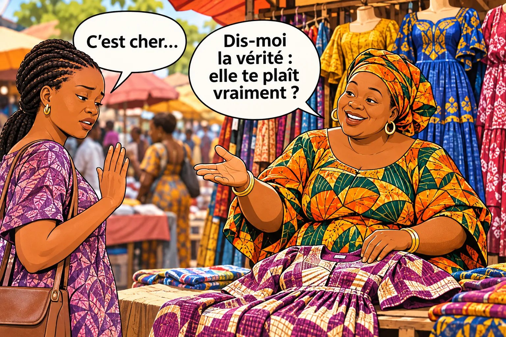

# Chapitre 1 — Le closing, c'est quoi ?

Le client était intéressé. Il a posé des questions. Il a peut-être même dit « oui »… et puis tout s'est arrêté. **Que s'est-il passé dans ces quelques secondes ?**

<figure class="ill"></figure>

### 🎬 Exemple 1 — Fanta, au marché

Une femme prend une robe bleue, la regarde à la lumière, la touche.
— C'est combien, celui-là ?
— 15 000 F, ma sœur.
— Hum… C'est cher. Je vais faire le tour.
Elle repose la robe et fait déjà un pas pour partir.

### 🎬 Exemple 2 — Sékou, le livreur

Le client a dit « oui » hier. Sékou arrive avec le colis. Le client l'ouvre, regarde, puis dit : « Hum… Finalement, c'est trop cher pour moi. Repars avec. » Le carburant et le temps de Sékou sont perdus.

### 👀 Tu as remarqué ?

Dans les deux exemples, **le client était intéressé**. Puis, en quelques secondes, tout s'est arrêté, et personne n'a rien fait de ce moment-là. Ce moment où le client hésite a un nom : c'est le moment du **closing**. C'est là que se gagnent ou se perdent la plupart des ventes.

## 1. Revenons à Fanta

La femme a reposé la robe. Elle fait déjà un pas pour partir. Fanta a **trois secondes** pour dire quelque chose.

### 🎯 À toi de jouer

**Si tu étais Fanta, tu dirais quoi ?**

- **A.** « D'accord ma sœur, à tout à l'heure. »
- **B.** « Non, ce n'est pas cher ! Regarde la qualité ! Je te la fais à 13 000, prends-la ! »
- **C.** « Pas de souci, fais le tour. Mais avant, dis-moi juste : la robe, elle te plaît ? »

### ✅ La bonne réponse : C

Fanta laisse la cliente libre, puis pose **une seule question, courte et gentille**. La cliente va peut-être dire :
- « Elle me plaît, mais je n'ai que 12 000 sur moi. » → C'est l'argent du moment.
- « Elle me plaît, mais j'ai peur qu'elle déteigne. » → C'est la qualité.
- « Pas trop, je cherchais du vert. » → Fanta montre sa robe verte.

Dans les trois cas, Fanta **apprend la vraie raison**. Elle peut enfin répondre à la bonne question.

**❌ Pourquoi pas A ?** Fanta laisse partir la cliente sans rien savoir. Elle ne saura jamais pourquoi.

**❌ Pourquoi pas B ?** Fanta se défend et baisse son prix **sans savoir si le prix était le problème**. Elle perd 2 000 F, et peut-être la vente quand même.

**👉 La bonne action :** quand un client veut partir, **ne le retiens pas, ne te défends pas**. Pose une question courte pour savoir ce qu'il pense vraiment.

Ce que Fanta vient de faire, c'est déjà du **closing**.

## 2. « Closing », en simple

« Closing » vient de l'anglais *to close* : **fermer**. Comme on ferme un sac quand tout est dedans. **Le closing, c'est le moment où la vente est bouclée** : le client dit « oui » et il paie. C'est aussi tout ce que tu fais pour l'amener jusque-là, surtout quand il hésite.

| | Vendre | Closer |
|---|---|---|
| **Ce que tu fais** | Tu montres le produit et tu donnes le prix. | Tu accompagnes le client jusqu'à la décision. |
| **Quand il dit « c'est cher »** | Tu dis « d'accord » ou tu baisses le prix. | Tu cherches **ce qu'il veut dire vraiment**. |
| **Résultat** | Tu vends aux clients déjà décidés. | Tu vends **aussi** à ceux qui hésitaient. |

Tout le monde sait vendre à un client décidé. **Le closer sait vendre au client qui hésite.** Et la plupart des clients hésitent.

## 3. Les 6 étapes de toute vente

Au marché, sur WhatsApp ou dans un bureau, toutes les ventes suivent le même chemin :

| Étape | Ce qui se passe | Au marché |
|---|---|---|
| **1. Le client s'arrête** | Il remarque ton produit ou ton message. | La femme s'arrête devant les robes. |
| **2. Il te laisse parler** | Il te donne un peu de son temps. | Elle demande le prix. |
| **3. Tu comprends ce qu'il veut** | Son besoin, son envie, pour qui il achète. | C'est pour un baptême. |
| **4. Il hésite** | « C'est cher », « je vais revenir » : c'est l'**objection**. | « Hum, c'est cher. » |
| **5. Tu lèves son doute** | Tu trouves sa vraie peur et tu y réponds. | Elle a peur que la robe déteigne : Fanta la rassure. |
| **6. Il dit oui et il paie** | La vente est bouclée. | Elle paie et repart avec sa robe. |

Attention : **« oui » et « payé », ce n'est pas la même chose.** En ligne, il y a un long chemin entre les deux : l'emballage, le livreur, la route. Tant que l'argent n'est pas reçu, la vente n'est pas bouclée. Et après l'étape 6, il y a un bonus : **le client revient et parle de toi à ses proches.**

### Les 3 endroits où les ventes meurent

- **À l'étape 2 : le client part avant même qu'on discute.** C'est le grand problème de la vente en Afrique → **chapitre 2**.
- **À l'étape 4 : le client hésite, et le vendeur ne sait pas quoi faire** → **chapitre 4** et toute la partie 3.
- **Entre le « oui » et le paiement : le client annule**, parfois quand le colis est déjà en route. C'est la blessure la plus chère, car tu as **déjà dépensé** → **chapitres 18 et 25**.

« Ils viennent, ils demandent le prix puis passent leur chemin. »
— un vendeur de bétail, Afrique de l'Ouest

On retrouve cette plainte dans la presse de nombreux pays africains. C'est l'une des plaintes les plus fréquentes des vendeurs.

## 4. Une objection, c'est quoi ?

Une **objection**, c'est **la raison que le client donne pour ne pas acheter maintenant**. Ce n'est pas une insulte, ni un « non » définitif. C'est **une pierre sur la route** : ton travail, c'est de trouver comment passer à côté. Il en existe 5 grandes familles :

| Ce que le client dit | La famille |
|---|---|
| « C'est cher. » « Diminue un peu. » « C'est quoi le dernier prix ? » | Le **prix** |
| « Je n'ai pas l'argent maintenant. » « À la fin du mois. » | L'**argent** et le **moment** |
| « C'est pas l'arnaque ? » « Je paie à la livraison. » | La **confiance** |
| « Je dois demander à mon mari. » « Le vieux doit voir. » | La **famille** et le décideur |
| « Je vais réfléchir. » « On va voir. » | Le **temps** et la **priorité** |

On les étudie une par une dans la partie 3.

## 5. La vente commence au premier « non »

Le formateur français **Bastien Pelissier** le dit en une phrase : **« La vente commence au premier non. »** Avant le « non », tout le monde sait montrer un produit et donner un prix. C'est après le premier « c'est cher » qu'on voit qui sait vraiment vendre.

### 🌍 Ce que les livres étrangers oublient

Les méthodes venues d'Europe ou d'Amérique imaginent un client **assis**, qui t'écoute pendant 30 minutes. **En Afrique, souvent, le client ne s'assoit pas : il passe.** Sur WhatsApp, il lit et il disparaît. Souvent, il ne dit même pas « non ». Pour nous, la vente commence donc **dès les premières secondes**, pour que le client reste assez longtemps pour **dire** son « non ». C'est tout le sujet du chapitre 2.

## 6. Closer, ce n'est pas forcer

Bastien Pelissier raconte qu'un jour, dans un souk, il était **déjà prêt** à acheter un tapis. Mais le vendeur lui a sauté dessus : « Prix d'ami ! Il n'en reste qu'un ! » Il s'est senti manipulé, il est parti, et il n'a jamais acheté.

> **Les gens adorent acheter, mais ils détestent avoir le sentiment qu'on leur vend.** (Jeffrey Gitomer, formateur américain)

Quand tu forces, le client se sent piégé et il part. Et il en parle autour de lui. Le vrai closer fait l'inverse : il **pose des questions, écoute, comprend**, puis il **aide** le client à décider. Si le produit n'est pas bon pour lui, il le lui dit.

## 7. Pourquoi ça vaut la peine

Un petit calcul. Chaque jour, **20 clientes** demandent les prix de Fanta. **2** achètent. Si Fanta garde **2 clientes de plus** dans la discussion, et qu'elles achètent, elle fait **4 ventes au lieu de 2**. Elle a doublé ses ventes sans plus de clientes, sans publicité et sans travailler plus longtemps. C'est ça, la force du closing.

### 👥 Dans ta situation : où meurent tes ventes ?

| Profil | Tes ventes meurent surtout… |
|---|---|
| **A — Fanta** | à l'étape 2 (le prix, puis le départ) et à l'étape 4 (« c'est cher », « je fais le tour ») |
| **B — Amina** | à l'étape 2 (deux coches bleues), à l'étape 5 (peur de l'arnaque) et après le « oui » (annulation) |
| **C — Ibrahima** | à l'étape 4 (« encore une arnaque ? ») et à l'étape 6 (abandon au moment de payer) |
| **D — Koffi** | à l'étape 4 (« je dois voir avec mon directeur », le devis sans réponse) |
| **E — Sékou** | entre le « oui » et le paiement (annulation en route, refus à la porte) |

### ✍️ Entraîne-toi : ta dernière vente perdue

1. À quelle **étape** le client est-il parti ? 
2. Qu'a-t-il **dit** juste avant ? Et **toi**, qu'as-tu répondu ? 
3. Sais-tu **pourquoi** il est vraiment parti ? Oui ☐ Non ☐ — Si c'est non, c'est normal : à la fin de la partie 1, tu sauras le découvrir.

### 📖 Les mots à connaître

| Mot | En simple |
|---|---|
| **Closing** | Le moment où le client dit « oui » et paie, et tout ce que tu fais pour l'y amener. |
| **Closer** | Le vendeur qui sait amener un client qui hésite jusqu'au « oui ». |
| **Client** | Quelqu'un qui pourrait acheter, mais n'a pas encore acheté. |
| **Objection** | La raison donnée pour ne pas acheter maintenant. |

### ✅ À retenir

- ☐ Le closing, c'est accompagner le client jusqu'au « oui » **et** jusqu'au paiement.
- ☐ Je sais à quelle étape je perds le plus de clients.
- ☐ Quand un client veut partir, je ne le retiens pas : je pose **une** question courte.
- ☐ Je ne force jamais un client.

⚠️ **L'erreur à éviter :** croire que le client qui dit « c'est cher » n'est pas intéressé. S'il n'était pas intéressé, il ne demanderait même pas le prix.

➡️ **Et maintenant ?** Le chapitre 2 s'attaque au plus gros problème : **le client qui demande le prix et qui part**. Sans lui, tu sauras répondre aux objections… mais tes clients partiront avant de te les dire.

