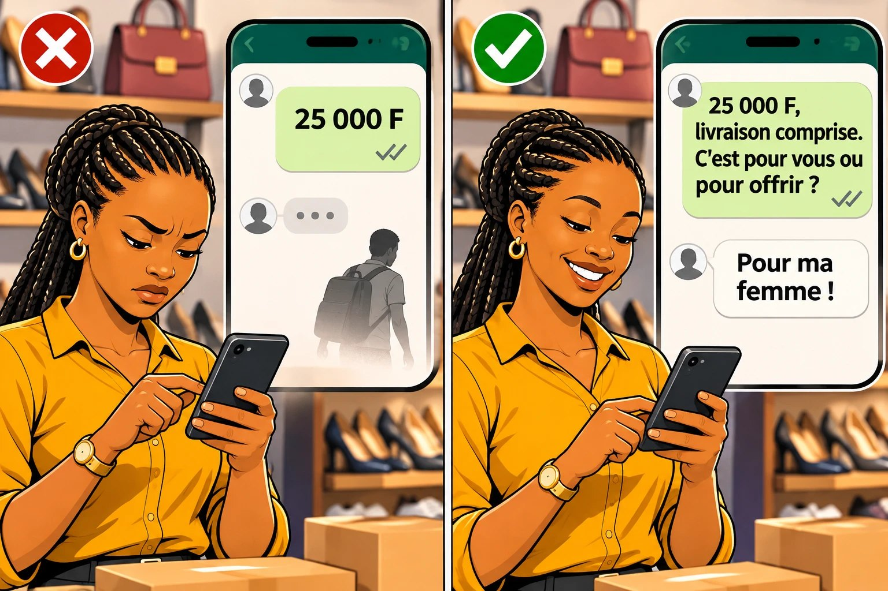

# Chapitre 2 — Le client qui demande le prix… et qui part

« C'est combien ? » Tu réponds. Et tu ne le revois plus jamais. **Combien de fois par semaine ça t'arrive ?** C'est le chapitre le plus important de la partie 1 : on ne peut pas convaincre un client qui est déjà parti.

### 🎬 Exemple 1 — Au marché, avec Fanta

Un homme passe devant l'étal de Fanta. Il montre une robe du doigt, sans s'arrêter vraiment.
— C'est combien ?
— 15 000.
Il hoche la tête et continue son chemin. Tout a duré **quatre secondes**.

### 🎬 Exemple 2 — Sur WhatsApp, avec Amina

**Client :** Bjr. Les baskets blanches c combien ?
**Amina :** Bonjour, 25 000 F.
*(Deux coches bleues : le client a lu. Une heure passe. Puis une journée. Rien.)*

### 👀 Tu as remarqué ?

Dans les deux exemples, **le vendeur a fait exactement ce qu'on lui demandait** : il a donné le prix. Et **la vente est morte juste après**. Ce n'est pas un hasard : c'est un piège dans lequel tombent même les bons vendeurs.

<figure class="ill"></figure>

« Les gens viennent, demandent les prix, touchent les articles, puis repartent. Je ne comprends pas. »
— un vendeur de fournitures scolaires, Afrique de l'Ouest

## 1. Pourquoi le client part : les 7 raisons

| # | La raison | Ce qui se passe dans sa tête |
|---|---|---|
| 1 | **Le prix est tombé « tout nu »** | Il a entendu un chiffre, mais rien sur ce qu'il gagne. Un chiffre seul fait peur. |
| 2 | **Il compare** | Il veut voir les autres vendeurs. C'est normal. |
| 3 | **Il n'a pas l'argent aujourd'hui** | Il se renseigne pour plus tard. Il a honte de le dire. |
| 4 | **Il a peur de négocier** | Il n'ose pas proposer un prix, de peur de te vexer ou d'être humilié. |
| 5 | **Il n'a pas confiance** | Surtout en ligne : « Ce vendeur existe vraiment ? » |
| 6 | **Il ne s'est pas senti accueilli** | Tu étais au téléphone, tu as répondu sèchement. |
| 7 | **Rien ne l'invite à rester** | Tu as donné le prix… et tu t'es tu. |

Regarde bien la raison n° 7 : **c'est la seule qui dépend entièrement de toi.** Quand tu donnes le prix et que tu te tais, c'est comme si tu disais : « Voilà le prix, maintenant tu peux partir. »

Et souvent, **tu ne sais pas** laquelle des 7 raisons tu as en face de toi. Ton premier objectif après le prix n'est donc pas encore de vendre : c'est de **garder la conversation ouverte** assez longtemps pour le découvrir.

## 2. La fenêtre des premières secondes

Quand un client demande le prix, une **petite fenêtre s'ouvre**. Elle reste ouverte **très peu de temps** : quelques secondes au marché, le temps de un ou deux messages sur WhatsApp. Pendant ce temps, le client décide s'il reste ou s'il part. Si tu ne fais rien, elle se ferme.

> En Afrique, le premier travail du closer n'est pas de répondre aux objections. **C'est de gagner le droit de discuter.**

Voici 4 règles, dans l'ordre : quand tu donnes le prix, quand il commence à partir, quand il est parti, et après.

## 3. Règle n° 1 — Ne donne jamais un prix « tout nu »

Attention : ça ne veut **pas** dire « cache ton prix ». Écrire « prix en inbox » fait fuir (chapitre 5). **Donne ton prix clairement, tout de suite.** Mais ne t'arrête pas après le chiffre.

### La formule : PRIX + QUESTION

Tu donnes le prix, puis tu enchaînes **tout de suite** avec **une question facile sur le client** (pas sur ton produit).

| Au lieu de dire… | Dis… |
|---|---|
| « 15 000. » | « 15 000. C'est pour une cérémonie ou pour tous les jours ? » |
| « 25 000 F. » | « 25 000 F, livraison comprise. Tu fais quelle pointure ? » |
| « Je vous envoie le devis. » | « Je vous l'envoie ce soir. Pour qu'il soit juste : vous commandez combien de ramettes par mois ? » |

**Pourquoi ça marche ?** Une question appelle une réponse. Le client pense à **son** besoin plutôt qu'à ton chiffre. Et sa réponse t'apprend quelque chose : « C'est pour un mariage » → il veut du beau. « Pour tous les jours » → il veut du solide.

**Une bonne question est facile** (on répond en 2 secondes), **sur le client** (son occasion, sa taille, à quoi il va servir) et **sans piège** (pas de « Tu le prends alors ? » tout de suite).

### 📱 En ligne : PRIX + PREUVE + QUESTION

Le client ne te voit pas et ne peut pas toucher. Ajoute **une preuve** entre le prix et la question :

> ✅ **Oui, disponible.** Les baskets blanches sont à **25 000 F**, livraison comprise.
> 📹 *(une courte vidéo des vraies baskets, filmée par toi)*
> Tu fais quelle pointure ? Il me reste du 40 au 44.

### 🎯 À toi de jouer

Ibrahima reçoit : « Slt, votre formation c'est combien ? » Quelle réponse garde le mieux la conversation ouverte ?

- **A.** « Bonjour ! 15 000 F. »
- **B.** « Bonjour ! Avant de vous donner le prix, je dois savoir si vous êtes sérieux. »
- **C.** « Bonjour et merci ! La formation complète est à 15 000 F, payable une seule fois par mobile money. Pour vous dire si elle est faite pour vous : vous vendez déjà en ligne, ou ce serait la première fois ? »

### ✅ La bonne réponse : C

Le prix arrive **tout de suite**, le paiement est rassurant, et le message finit par **une question facile** sur le client.

**❌ Pourquoi pas A ?** Un prix « tout nu » : rien n'invite à répondre.

**❌ Pourquoi pas B ?** Ibrahima cache son prix et **juge** le client. Il va se vexer.

**👉 La bonne action :** prépare **à l'avance** ta phrase PRIX + QUESTION pour tes produits les plus demandés.

## 4. Règle n° 2 — Quand il commence à partir : la question de la dernière chance

Même avec un bon prix, beaucoup de clients commencent à partir. Au marché, ils font un pas de côté. En ligne : « Ok merci ». Pose alors **une seule question**, courte, gentille, qui le laisse **libre** :

| Question | Quand l'utiliser |
|---|---|
| **« Avant de partir, dis-moi juste : ça te plaît ? »** | Quand tu ne sais pas ce qu'il pense. C'est la question universelle. |
| **« C'est le prix ou le modèle qui ne va pas ? »** | Quand il hésite sur quelque chose de précis. |
| **« Tu avais prévu combien ? Je te montre ce que j'ai dans ton budget. »** | Quand c'est l'argent. Tu ne baisses pas : tu proposes **autre chose**. |
| **« Tu compares, c'est normal. Tu cherches quoi exactement ? »** | Quand il va « faire le tour ». |

Tu ne lui barres pas la route, tu ne le tiens pas par le bras. C'est la différence entre un **closer** et un **racoleur** : le racoleur retient, le closer **ouvre une porte**.

### 🎬 L'exemple 1, rejoué

— C'est combien ?
— 15 000. C'est pour une cérémonie ?
— Non… je regarde seulement. *(il continue à marcher)*
— Pas de souci, grand frère. C'est pour toi ou pour offrir ?
*(Il ralentit.)* — Pour ma mère. Elle aime le bleu.
— Viens voir ! J'ai un bleu que les mamans adorent. Je te montre, tu n'es pas obligé.

**La fenêtre est restée ouverte.** Fanta a maintenant une vraie information : un cadeau pour sa mère, qui aime le bleu.

Dans une friperie, des chercheuses ont enregistré cette scène. Une cliente rend le linge et commence à partir. Le vendeur dit simplement : « Ne pars pas ! On peut parler. Tu veux payer combien ? » La cliente propose un prix, ils discutent, et elle achète.
— marchandage enregistré par des chercheuses, Afrique centrale

## 5. Règle n° 3 — Quand il est parti : une raison et un moyen de revenir

Une vente perdue aujourd'hui n'est pas perdue pour toujours, si tu laisses au client **un moyen** de revenir (ton numéro WhatsApp, ta carte, l'endroit exact de ta boutique) et **une raison** de revenir (« Je reçois du nouveau la semaine prochaine, laisse-moi ton numéro, je t'envoie la vidéo »). Et la phrase qui garde la porte ouverte : « Si tu trouves la même chose ailleurs, reviens me voir, on discute. »

### En ligne : la relance en 3 messages

| Quand | Le message | Le but |
|---|---|---|
| **Le lendemain** | « Bonjour ! Vous avez trouvé votre pointure ? J'ai reçu du 42 ce matin, si besoin 🙂 » | Revenir avec **une information utile**, pas avec « alors ? ». |
| **2 ou 3 jours après** | « Je prépare les livraisons de jeudi. Je vous mets les baskets de côté, ou ce n'est pas le moment ? » | Une question **fermée**, qui accepte le « non ». |
| **Une semaine après** | « Je ne vais pas vous déranger plus. Si un jour vous cherchez des baskets, je suis là. Bonne journée ! » | Fermer la porte **poliment**. |

Après le 3ᵉ message, **tu arrêtes**. Au-delà, c'est du harcèlement. Et jamais de fausse urgence (« Il n'en reste qu'un ! ») si ce n'est pas vrai : on en reparle au chapitre 27.

## 6. Règle n° 4 — Accepte de perdre, mais apprends

Personne ne vend à tous les clients. Certains étaient seulement curieux, d'autres n'avaient vraiment pas d'argent. Mais chaque client qui part peut **t'apprendre quelque chose**, si tu notes ce qui s'est passé :

| Date | Produit | Ce qu'il a dit | Ce que j'ai répondu | La raison |
|---|---|---|---|---|
| Lundi | Robe bleue | « C'est cher » | « Ça te plaît ? » | Elle voulait 2 robes pour 20 000 |
| Mardi | Basket 42 | (vu, pas de réponse) | Relance le lendemain | Pas encore payé |

Au bout d'une semaine, des choses reviennent : « On me demande souvent des lots de 2 », « On me demande si ça déteint ». Ces informations valent de l'or : elles te disent **quoi dire avant même qu'on te le demande**.

### 👥 Dans ta situation : ta phrase PRIX + QUESTION

| Profil | Ta phrase |
|---|---|
| **A — Fanta** | « 15 000. C'est pour une cérémonie ou pour tous les jours ? » |
| **B — Amina** | « ✅ Disponible. 25 000 F livraison comprise. 📹 Tu fais quelle pointure ? » |
| **C — Ibrahima** | « 15 000 F, une seule fois. Vous voulez lancer votre business ou développer celui que vous avez ? » |
| **D — Koffi** | « Je vous envoie le devis ce soir. Combien de ramettes utilisez-vous par mois ? » |
| **E — Sékou** | À la porte, le client fait la grimace devant le total : « C'est 27 000 avec la livraison, comme convenu. Vous voulez ouvrir et vérifier d'abord ? » |

### ✍️ Entraîne-toi

**1.** Écris ta phrase PRIX + QUESTION pour tes 3 produits les plus demandés.

**2.** Réécris ce message pour garder la conversation ouverte. Le client : « Le sac noir c'est combien ? » Le vendeur : « 18 000. »

*Une réponse possible :* « Le sac noir est à **18 000 F**, avec une poche intérieure fermée. 📹 *(vidéo)* C'est plutôt pour le travail ou pour sortir ? J'ai aussi le même en marron. »

### 📖 Les mots à connaître

| Mot | En simple | En pro |
|---|---|---|
| **Prix « tout nu »** | Un chiffre donné seul, sans rien autour. | Annonce de prix sans valeur ni relance. |
| **Fenêtre** | Les quelques secondes où le client décide de rester ou de partir. | Moment critique d'engagement après la demande de prix. |
| **Relance** | Recontacter un client qui n'a pas encore décidé. | *Follow-up* : suivi commercial d'un prospect. |
| **Racoleur** | Un vendeur qui retient ou attrape les clients. | Sollicitation commerciale insistante. |

### ✅ À retenir

- ☐ Je donne mon prix clairement, tout de suite, puis **une question** (+ une preuve en ligne).
- ☐ Je connais par cœur ma question de la dernière chance.
- ☐ Je laisse toujours au client un moyen de revenir.
- ☐ En ligne, je relance 3 fois au maximum, avec quelque chose d'utile.
- ☐ Je note chaque client qui part et ce qu'il a dit.

⚠️ **L'erreur à éviter :** croire que le client qui part « n'était pas sérieux ». Avant d'accuser le client, regarde ce que tu as dit juste après le prix.

➡️ **Et maintenant ?** Le client reste et parle. Il faut maintenant comprendre **ce qui se passe dans sa tête** : c'est le chapitre 3.

