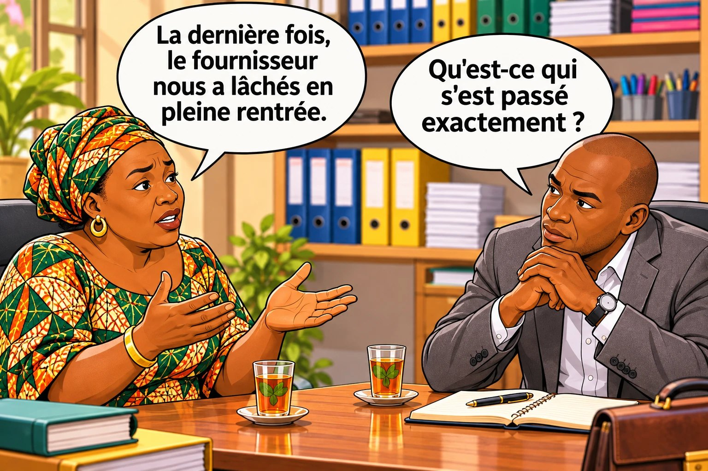

# Chapitre 9 — É comme Écouter : comprendre d'où vient la peur

Le client vient enfin de te dire sa vraie peur. Tu as envie de foncer pour le rassurer. **Stop. C'est exactement le moment où beaucoup de ventes se cassent.**

### 🎬 Exemple 1 — Fanta, au marché

La cliente a fini par dire : « Elle est belle… mais j'ai peur qu'elle déteigne au premier lavage. » Fanta répond tout de suite, très fort : « Non, non, non ! Elle ne déteint pas ! Je te jure ! » La cliente sourit poliment, repose la robe : « D'accord, je vais voir. »

### 🎬 Exemple 2 — Sékou, le livreur

**Client :** La dernière fois, avec votre boutique, le colis était tout abîmé.
**Sékou :** Ah ça, ce n'est pas moi, hein. Moi je fais seulement la livraison.
*(Le client hésite… puis : « Rapporte-le, je vais rappeler la boutique. »)*

### 👀 Tu as remarqué ?

Le vendeur a fait la partie difficile : le client a **dit sa vraie peur**. Et puis… il a **foncé** : il a juré, il s'est défendu. Il a répondu à la peur **sans la comprendre**. Le client a senti un vendeur pressé de vendre, pas une personne qui l'écoutait.

<figure class="ill"></figure>

## 1. Pourquoi foncer fait fuir

Mets-toi à la place du client. Tu viens de dire ce qui te fait peur, et le vendeur répond en une seconde : « Non, ce n'est pas vrai ! Faites-moi confiance ! » Tu penses : **« Évidemment qu'il dit ça. Il veut vendre. »** Comme le dit Bastien Pelissier, **les clients ne sont pas idiots** : quand tu fonces, ta parole ne vaut presque rien. Et la pression monte encore. Un client coincé fait une seule chose : **il cherche la sortie.**

> **Quand le client dit sa peur, ton travail n'est pas encore de répondre. C'est de comprendre.**

Mets tes **« habits de détective »** : un détective ne crie pas « Je sais qui est le coupable ! » dès la première minute. Il pose des questions et il cherche les indices.

## 2. Le moment du thé

Pelissier appelle cette étape le **« tea time »**, le moment du thé : tu discutes avec ton client **comme autour d'un thé**, tranquillement, sans pression. Et ce moment, beaucoup d'Africains le connaissent déjà : les longues salutations, le thé partagé, les nouvelles de la famille (souviens-toi du souk du chapitre 6). Tu n'as pas à apprendre une technique étrangère : tu ramènes dans ta vente ce que tu fais déjà avec les gens que tu respectes.

Attention : le moment du thé n'est pas du bavardage. Il a un but précis : **que le client raconte ce qui l'inquiète, avec ses mots à lui.**

Des chercheurs ont enregistré cet échange. Le client explique qu'il gagne très peu. La vendeuse, sèche juste avant, sourit et répond : « La vie est dure dans ce pays et nos dirigeants sont occupés à voler notre argent. Dieu nous sauvera. » Selon les chercheurs, à partir de là, l'échange redevient **coopératif** : le client et la vendeuse sont du même côté.
— marchandage enregistré par des chercheurs, marché d'Afrique de l'Ouest

La vendeuse n'a pas baissé son prix. Elle a montré qu'elle **comprenait**. Ce petit moment a changé toute l'ambiance.

## 3. Écouter pour de vrai

La plupart des vendeurs **attendent leur tour pour parler** : pendant que le client parle, ils préparent leur réponse. L'**écoute active**, une idée des psychologues américains **Carl Rogers et Richard Farson** (1957), c'est autre chose :
- **t'arrêter de faire autre chose** : poser ton téléphone, lire **tout** le message avant de répondre ;
- **chercher à comprendre, pas à répondre** : « Qu'est-ce qu'il veut dire exactement ? » ;
- **montrer que tu as compris** : « Si je comprends bien, la dernière fois le colis est arrivé abîmé, et vous avez peur que ça recommence. »

On entend souvent : « Un bon vendeur écoute 80 % du temps. » **Ce chiffre n'a aucune source.** Ce qui a été mesuré : l'entreprise **Gong** a étudié environ **326 000 appels** de vente entre entreprises en 2025. Dans les ventes **gagnées**, le vendeur parlait environ **57 %** du temps ; dans les ventes **perdues**, environ **62 %**. La différence n'est pas énorme, mais elle va dans le même sens : **le vendeur qui gagne parle un peu moins.** Retiens : écoute plus que tu ne parles, surtout juste après que le client a dit sa peur.

### 🎯 À toi de jouer

Le client d'Amina écrit : « Franchement les baskets me plaisent. Mais j'ai déjà été arnaqué une fois sur Facebook. » **Quelle est la meilleure réponse ?**

- **A.** « Je comprends. Moi je ne suis pas comme eux, je suis 100 % sérieuse, regardez mes avis. »
- **B.** « Oh, désolée que ça vous soit arrivé, c'est vraiment pénible. Ça s'est passé comment, si je peux demander ? »
- **C.** « Ok. Donc vous prenez quelle pointure ? »

### ✅ La bonne réponse : B

Amina **reconnaît** ce que le client a vécu, sans se défendre, puis lui demande de **raconter**. Elle va découvrir exactement ce qui s'est passé (le vendeur a disparu après l'acompte ? le produit était faux ?), et donc **quoi** rassurer.

**❌ Pourquoi pas A ?** C'est exactement ce que disent… tous les arnaqueurs.

**❌ Pourquoi pas C ?** Le client se sent ignoré, et sa peur est toujours là.

**👉 La bonne action :** reconnais ce qu'il ressent, puis demande-lui de **raconter**.

## 4. Les 4 outils de l'écoute

1. **« Qu'est-ce qui vous fait penser ça ? »** Elle ne juge pas, elle invite à expliquer. « J'ai peur qu'elle déteigne. » → « Ah bon ? Qu'est-ce qui te fait penser ça ? » L'ancien négociateur du FBI **Chris Voss** conseille les questions en **« Comment… ? »** ou **« Qu'est-ce que… ? »** plutôt qu'en « Pourquoi ? », qui met sur la défensive.
2. **« Racontez-moi. »** « Ça vous est déjà arrivé ? Ça s'est passé comment ? » Chaque détail de l'histoire est **un indice**.
3. **L'effet miroir** (Chris Voss). Tu répètes les **1 à 3 derniers mots** du client, sur un ton de question… puis tu te tais.

| Le client dit | Effet miroir | Ce qui se passe |
|---|---|---|
| « Notre dernier fournisseur nous a laissé tomber. » | « Laissé tomber ? » | Elle raconte : retards, téléphone qui ne répond plus, rupture en pleine rentrée. |
| « Le colis était tout abîmé. » | « Tout abîmé ? » | Il raconte : boîte écrasée, chaussures rayées. |
| « Je ne sais pas si c'est pour quelqu'un comme moi. » | « Quelqu'un comme vous ? » | « Je n'ai jamais vendu en ligne, je ne suis pas fort avec le téléphone. » |

4. **Le silence.** Après ta question, **tais-toi**. Compte jusqu'à 5. C'est dans ce silence que le client ajoute ce qu'il n'avait pas encore dit.

**En ligne aussi, on écoute :** lis tout le message, réponds en une phrase pour reconnaître et une question pour comprendre, pas avec un pavé. L'effet miroir marche par écrit (« Arnaqué ? 😔 Ça s'est passé comment ? »). Et si la peur est forte, propose un vocal : une voix calme rassure plus que dix lignes.

## 5. Trouver d'où vient la peur

Pelissier parle de trouver **« l'épiphanie de la crainte »** : le moment précis qui a fait naître la peur. Presque toutes les peurs ont une de ces **4 sources** :

| La source | Exemple | Ce que ça t'apprend |
|---|---|---|
| **1. Il l'a vécu** | « La dernière fois, le colis est arrivé abîmé. » | Sa peur est concrète : il faudra une preuve concrète. |
| **2. Un proche l'a vécu** | « Mon cousin a payé une avance et n'a rien reçu. » | Elle peut être très forte, même si elle ne te concerne pas. |
| **3. Il l'a entendu dire** | « On dit que ces formations, c'est des arnaques. » | C'est une réputation générale : il ne te connaît pas encore. |
| **4. Sa situation actuelle** | « Je ne suis pas fort avec le téléphone. » « Ma paie tombe le 30. » | C'est sa réalité d'aujourd'hui : souvent un **mur** (chapitre 4). |

### 🎬 Sékou rejoue la scène

**Client :** La dernière fois, le colis était tout abîmé.
**Sékou :** Tout abîmé ?
**Client :** Oui ! La boîte était écrasée, une chaussure était rayée. J'ai dû me battre pour qu'on me l'échange.
**Sékou :** Je comprends que vous soyez méfiant. On ouvre le carton ensemble, ici, avant que vous payiez ? Vous vérifiez tout tranquillement.
**Client :** … Oui, ouvrons.

Sékou n'a rien juré. Il a **écouté**, trouvé **la source** (une expérience précise) et proposé une réponse **qui correspond exactement** à cette peur.

## 6. La peur est-elle fondée ?

Une fois la source trouvée, demande-toi honnêtement : **le client a-t-il raison d'avoir peur ?**

| Si la peur est… | Exemple | Ce que tu fais |
|---|---|---|
| **Non fondée** | Il croit que la robe déteint, mais tu l'as lavée toi-même dix fois. | Clé **A** (chapitre 10) : tu lui **montres** qu'il peut être rassuré. |
| **Fondée, avec une solution** | Il a peur que la livraison arrive abîmée. C'est déjà arrivé. | Tu proposes la solution : vérifier avant de payer, emballage renforcé, échange. |
| **Fondée, et ton produit ne lui convient pas** | La formation demande un ordinateur, et il n'en a pas. | **Tu ne vends pas.** Tu le lui dis, et tu l'orientes si possible. |

Pelissier le dit : il refuse d'accompagner quelqu'un qu'il ne pense pas pouvoir aider. Un client mécontent réclame, demande à être remboursé, et surtout **il parle**. En Afrique, où le bouche-à-oreille fait ou défait une réputation, c'est encore plus vrai.

> **Le moment du thé ne sert pas à trouver un « angle d'attaque » pour vendre à tout prix. Il sert à savoir si tu dois vendre.**

### 👥 Dans ta situation : ta clé É

| Profil | Comment écouter |
|---|---|
| **A — Fanta** | « Elle déteint ? Ça t'est déjà arrivé avec une autre robe ? » Puis elle écoute. Il faudra **montrer** une preuve, pas jurer. |
| **B — Amina** | « Arnaqué ? 😔 Ça s'est passé comment ? » Si la peur est forte : « Je peux vous envoyer un petit vocal ? » |
| **C — Ibrahima** | « Quelqu'un comme vous ? Qu'est-ce qui vous fait douter exactement ? » Et il accepte de ne pas vendre si ça ne convient pas. |
| **D — Koffi** | « Laissé tomber ? » puis silence. Il note tout : ce sont les points qu'il devra rassurer. |
| **E — Sékou** | « Tout abîmé ? » puis « On ouvre ensemble avant que vous payiez ? » Il ne dit jamais « ce n'est pas moi » : pour le client, **le livreur, c'est la boutique**. |

### ✍️ Entraîne-toi : le jeu du miroir (à deux, 5 minutes)

Un proche te raconte sa journée, un problème au travail, un achat raté. Tu as le droit de dire **seulement** deux choses : répéter ses 1 à 3 derniers mots sur un ton de question, ou te taire. Au bout de 5 minutes, demande-lui : « Est-ce que tu t'es senti écouté ? »

### 📖 Les mots à connaître

| Mot | En simple | En pro |
|---|---|---|
| **Écoute active** | Écouter pour comprendre, et montrer qu'on a compris. | Technique de communication (Rogers et Farson, 1957) : attention, reformulation. |
| **Effet miroir** | Répéter les derniers mots du client sur un ton de question. | *Mirroring* (Chris Voss). |
| **Peur fondée** | Une peur qui correspond à un vrai risque. | Objection légitime, justifiée par les faits. |
| **Source de la peur** | L'événement ou l'histoire qui a fait naître la peur. | Origine de l'objection (vécue, rapportée, réputation, contrainte). |

### ✅ À retenir

- ☐ Quand le client dit sa peur, je ne fonce pas : je reconnais d'abord ce qu'il ressent.
- ☐ Je demande « Qu'est-ce qui vous fait penser ça ? », j'utilise l'effet miroir, et je me tais.
- ☐ Je laisse le client raconter son histoire jusqu'au bout.
- ☐ Je cherche la source de sa peur, puis je décide honnêtement si elle est fondée.
- ☐ Si mon produit ne lui convient pas, je le lui dis.

⚠️ **L'erreur à éviter :** utiliser le moment du thé comme une ruse, pour trouver le point faible du client. Il finit toujours par le sentir. **Écoute sincèrement, ou n'écoute pas du tout.**

➡️ **Et maintenant ?** Tu connais la peur et sa source. La clé **A comme Apaiser** (chapitre 10) t'apprend à l'enlever sans forcer : ses propres paroles, des histoires vraies, des preuves, et la valeur plutôt que le prix.

