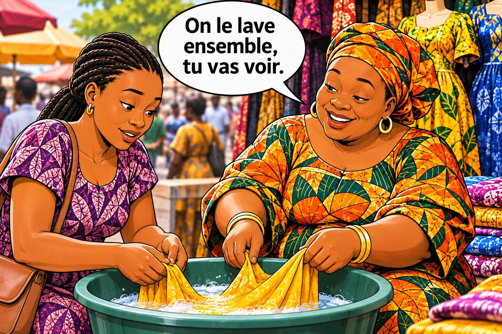

# Chapitre 10 — A comme Apaiser : enlever la peur sans forcer

Ton client ne croit pas ce que **tu** dis. Il croit ce que **lui** a dit, ce qu'il **voit** de ses yeux, et les **histoires** qu'il entend. Ce chapitre t'apprend à rassurer avec ces trois choses-là.

### 🎬 Exemple 1 — Fanta jure

La cliente a peur que la robe jaune déteigne : elle a déjà acheté une robe qui a perdu sa couleur au premier lavage.
**Fanta :** Je te jure sur ma mère, celle-là ne déteint pas !
**Cliente :** Hum… On dit tous ça.

### 🎬 Exemple 2 — Ibrahima oublie ce que le client a dit

Au début, le client a écrit : « Je perds au moins trois clients par semaine parce que je ne sais pas leur répondre. » Dix minutes plus tard : « 15 000 F, c'est trop cher pour moi. » Ibrahima répond : « Ce n'est pas cher, il y a 12 modules et 4 bonus. » *(Le client ne répond plus.)*

### 👀 Tu as remarqué ?

Le vendeur sait **ce qui fait peur** au client. Mais pour rassurer, il a choisi les **mauvais outils**. Il a **juré**, et le client se méfie de la parole d'un vendeur. Et il a **défendu son prix** avec ses propres arguments. Il aurait dû rappeler ce que le client avait dit lui-même. D'autres vendeurs font pire : ils **baissent leur prix** tout de suite (le client apprend à toujours demander moins) ou ils **s'énervent** (le client perd la face).

<figure class="ill"></figure>

## 1. La règle des 3 choses (+ 1)

Bastien Pelissier donne une règle simple. Pour rassurer sans forcer, **seules 3 choses doivent sortir de ta bouche** :
1. **des questions** : le client réfléchit et trouve lui-même la réponse ;
2. **les propres paroles du client** : il ne te croit pas toi, mais **il se croit lui-même** ;
3. **des histoires vraies** : elles se retiennent et ne ressemblent pas à un argument de vendeur.

Et en Afrique, où la confiance est la réalité n° 1, on ajoute : **4. des preuves que le client peut vérifier lui-même.**

Ce qui **n'est pas** dans la liste : les serments, les promesses, les longs discours, la critique des concurrents. Tout ça, c'est **ta** parole. Apaiser, c'est rassurer **sans** donner au client le sentiment qu'on lui vend.

## 2. Les propres paroles du client

Pendant les clés I et É, ton client t'a dit beaucoup de choses : pour qui il achète, ce qui l'embête, ce que ça lui coûte. **Ces phrases-là sont de l'or.** Au moment où il hésite, rappelle-lui simplement ce qu'il a dit.

**Pourquoi ça marche ?** Les gens n'aiment pas se contredire. Le chercheur américain **Robert Cialdini** (livre *Influence*) appelle ça le principe d'**engagement et de cohérence**. Une expérience célèbre le montre (Freedman et Fraser, 1966) : des chercheurs ont demandé à des habitants d'accepter un grand panneau dans leur jardin. Parmi ceux à qui on n'avait rien demandé avant, environ **17 %** ont accepté. Parmi ceux qui avaient accepté une **toute petite demande** deux semaines plus tôt, environ **76 %** ont accepté. **Ce que le client a dit lui-même pèse plus lourd que ce que tu lui dis.**

| Il a dit plus tôt… | Il hésite… | Tu lui rappelles ses paroles |
|---|---|---|
| « Je perds au moins trois clients par semaine. » | « 15 000 F, c'est trop cher. » | « Vous m'avez dit que vous perdiez trois clients par semaine. Ces trois clients, ils vous rapportent combien ? » |
| « C'est pour le baptême de ma fille, samedi. » | « Je vais encore réfléchir. » | « Tu m'as dit que c'est pour samedi : je te la mets de côté jusqu'à demain, pour être sûre de l'avoir ? » |
| « On a manqué de papier deux fois pendant la rentrée. » | « Je dois voir avec mon directeur. » | « Vous voulez que je prépare une petite note pour lui, avec la date de livraison écrite, avant la rentrée ? » |

Tu n'as rien inventé ni juré. Ce n'est plus toi qui pousses : c'est le client qui se rappelle pourquoi il voulait acheter.

### 🎯 À toi de jouer

Au début, une cliente a dit à Fanta : « C'est pour le mariage de ma sœur. Je ne veux pas avoir honte devant la belle-famille. » Elle essaie une robe verte, la trouve belle… puis : « 15 000, c'est trop. » **Que répond Fanta ?**

- **A.** « La honte devant la belle-famille, ça coûte plus que 15 000 ! Prends-la ! »
- **B.** « D'accord, je te la fais à 12 000. »
- **C.** « Je comprends, ce n'est pas rien. Tu m'as dit que c'est pour le mariage de ta sœur, devant la belle-famille. Tu te sens comment dedans ? »

### ✅ La bonne réponse : C

Fanta **reconnaît** que le prix n'est pas rien, **rappelle les mots** de la cliente sans les déformer, puis pose **une question**. Si la cliente répond « Je me sens bien », c'est **elle-même** qui vient de se convaincre.

**❌ Pourquoi pas A ?** Fanta se sert des mots de la cliente comme d'**une arme**, pour lui faire peur. La cliente se sent manipulée.

**❌ Pourquoi pas B ?** Fanta baisse son prix sans rien savoir, et perd 3 000 F pour rien.

**👉 La bonne action :** retiens les phrases importantes du client, et au moment où il hésite, **rappelle-les-lui doucement**, puis pose une question.

## 3. Nommer ce que le client ressent

Cet outil vient de **Chris Voss**. Il a travaillé **24 ans au FBI**, où il négociait pour libérer des personnes enlevées à l'étranger. Son livre : *Never Split the Difference* (2016), en français *Ne coupez jamais la poire en deux*. Petite précision honnête : Pelissier raconte une histoire de braqueur attribuée à Voss qui **ne se trouve pas dans son livre**. Voici la vraie technique.

**L'étiquetage**, c'est **nommer à voix haute ce que l'autre ressent**, avec « **On dirait que…** », « **J'ai l'impression que…** ». Tu ne dis pas « je suis d'accord » : tu dis « je vois ce que tu ressens ».

| Le client dit | Tu étiquettes |
|---|---|
| « J'ai déjà été arnaqué sur Facebook. » | « On dirait que cette histoire vous a laissé un mauvais souvenir. » |
| « Votre prix est plus élevé que les autres. » | « J'ai l'impression que vous avez peur de payer trop cher. » |
| « Je ne sais pas si c'est pour quelqu'un comme moi. » | « On dirait que vous avez peur de ne pas y arriver. » |

Une peur qu'on a nommée devient souvent **moins forte**. Le client répond : « Oui, c'est exactement ça. » Il se sent enfin compris. **D'abord tu nommes ce qu'il ressent** (il se sent compris), **ensuite tu rappelles ce qu'il a dit** (il se rappelle pourquoi il est là).

### 🌍 Dire la peur avant le client

Voss conseille aussi l'**audit des accusations** : au tout début, dire soi-même ce que l'autre **pourrait** penser. Dans un pays où beaucoup se méfient des vendeurs en ligne, c'est très puissant :

> « Vous vous dites peut-être : "Encore un vendeur en ligne qui va prendre mon argent et disparaître." C'est normal, il y a beaucoup d'arnaques. C'est pour ça que chez moi, vous payez seulement à la réception. »

Tu as dit la peur **avant** lui : elle perd sa force.

## 4. Montrer au lieu de dire

**Une preuve rassure seulement si le client peut la vérifier lui-même.**

| Preuve faible (facile à fabriquer) | Preuve forte (vérifiable) |
|---|---|
| Vingt captures d'écran de « clients contents » | **Un vrai client** que le client peut appeler |
| « Je te jure que ça ne déteint pas » | **Laver un bout de tissu devant la cliente**, ou montrer une robe déjà lavée dix fois |
| Une photo trouvée sur internet | **Une vidéo filmée aujourd'hui**, avec ta main et ta voix |
| « On livre partout sans problème » | **Le paiement à la réception**, et l'ouverture du colis avant de payer |
| « Ma formation marche » | **Un extrait gratuit**, une politique de remboursement écrite et claire |

« Assure-toi que ce que tu proposes à un client est authentique, parce que ça parlera toujours pour toi. »
— un vendeur de téléphones, Afrique de l'Ouest (traduit de l'anglais)

**Ne dis pas que c'est vrai. Montre-le.** (Le chapitre 14 t'aide à construire ta « preuve de confiance » une fois pour toutes.)

## 5. Les histoires vraies

Un argument ressemble à un argument de vendeur. Une histoire, non. Quand un client dit « Je ne suis pas fort avec le téléphone », Ibrahima ne répond pas « Mais si, vous allez y arriver ! ». Il raconte :

> « Une de mes premières élèves m'a dit exactement la même chose. Elle vendait des pagnes et n'avait jamais utilisé WhatsApp Business. Les deux premières semaines, elle m'appelait tous les deux jours. Aujourd'hui, c'est elle qui explique à ses copines comment faire leur catalogue. »

**L'histoire doit être vraie** : c'est la règle absolue. **Une peur = une histoire** : tu construiras ta **boîte à histoires** au chapitre 26.

## 6. Quand c'est un mur : un choix entre deux portes

Si la peur est en fait un **vrai mur** (pas l'argent aujourd'hui, le mari qui décide), apaiser veut dire **proposer une porte**. Et le mieux, c'est **un choix entre deux** :
- « Je te la mets de côté jusqu'à vendredi avec un petit acompte, ou on la livre le jour de ta paie ? »
- « J'appelle votre mari pour lui expliquer, ou je vous envoie une vidéo à lui montrer ? »

Avec deux choix, le client ne se sent pas poussé : il **décide**. Les portes sont détaillées dans la partie 3, objection par objection.

## 7. Négocier la valeur, pas le prix

Il reste « **c'est cher** », quand c'est une négociation et pas un vrai mur. La règle de Pelissier : **on ne négocie jamais sur le prix, on négocie sur la valeur.** Au lieu de baisser, tu **ajoutes** quelque chose qui te coûte peu. Et les vendeurs africains le font déjà. Voici des techniques réelles, enregistrées sur des marchés ou racontées par des vendeurs :

| Technique | Ce qu'on a entendu |
|---|---|
| **Le silence** | Une cliente demande une baisse, puis un cadeau. La vendeuse **ne répond pas**. « Ah, tantie, tu ne nous aimes pas ? » Silence. La cliente finit par **payer le prix annoncé**. *(marché d'Afrique de l'Ouest, traduit du pidgin)* |
| **« Ajoute un peu, et je fais de toi ma cliente »** | « Tu me le fais à 350 ? » — « Ajoute 50, et je fais de toi ma cliente. » — « Bon, emballe-le. » *(traduit de l'igbo)* |
| **Le cadeau à la place de la remise** | Le chargeur offert du chapitre 3, le *jara* au Nigeria : un petit plus qui coûte peu, annoncé clairement. |
| **La remise justifiée** | « D'accord, mais seulement parce que tu es mon client habituel. » *(Afrique de l'Est, traduit du swahili)* Le geste devient une **récompense**, pas un caprice. |
| **Ton vrai prix d'achat** | « Je l'ai acheté 5 900 l'unité, je ne gagne que 100. Même mon transport n'y est pas ! » *(vendeuse de poisson séché)* ⚠️ **Seulement si c'est vrai.** |
| **Deux prix au lieu d'un** | « Je leur propose souvent deux prix, et je les laisse choisir. » Le client ne se demande plus « j'achète ? » mais « **lequel** ? ». |

| Profil | Un petit plus qui coûte peu |
|---|---|
| **A — Fanta** | Un foulard assorti, l'ourlet retouché gratuitement |
| **B — Amina** | La livraison offerte, un sachet de protection |
| **C — Ibrahima** | Un appel de 30 minutes en plus, un modèle de messages prêt à copier |
| **D — Koffi** | La livraison express offerte sur la première commande |
| **E — Sékou** | Son **service** : attendre que le client vérifie, monter le colis à l'étage |

### 👥 Dans ta situation : ta clé A

| Profil | Comment apaiser |
|---|---|
| **A — Fanta** | « Tu m'as dit que c'est pour le mariage de ta sœur. On lave ce petit bout de tissu ensemble, tu vas voir qu'il ne bouge pas. » |
| **B — Amina** | « Vous vous dites peut-être : encore une vendeuse qui va disparaître. Chez moi, vous payez à la réception, et vous ouvrez le colis devant le livreur. » |
| **C — Ibrahima** | « On dirait que vous avez peur de ne pas y arriver. Je vous envoie le premier module gratuitement : regardez-le, et dites-moi si vous l'avez compris. » |
| **D — Koffi** | Au lieu de baisser de 5 % : « Notre prix est le même pour tous. Mais vous m'avez dit que la rentrée est critique : je vous écris dans le contrat la livraison avant le 1ᵉʳ septembre. » |
| **E — Sékou** | « Je comprends, 3 000 F, ce n'est pas rien. C'est le prix convenu avec la boutique. On l'appelle ensemble ? » Le client ne doit pas perdre la face. |

### ✍️ Entraîne-toi : ta fiche « une peur, une réponse »

Prends la peur que tes clients te disent le plus souvent. Écris : les paroles du client que tu peux rappeler · ta phrase « On dirait que… » · ta preuve · ton histoire vraie · ton petit plus qui coûte peu.

### 📖 Les mots à connaître

| Mot | En simple | En pro |
|---|---|---|
| **Cohérence** | On n'aime pas se contredire. | Engagement et cohérence (Cialdini). |
| **Étiquetage** | Mettre un mot sur ce que l'autre ressent : « On dirait que… ». | *Labeling* (Chris Voss). |
| **Audit des accusations** | Dire soi-même, au début, ce que le client pourrait reprocher. | *Accusation audit* (Chris Voss) : désamorçage préventif des objections. |
| **Preuve vérifiable** | Une preuve que le client peut contrôler lui-même. | Élément de réassurance objectivable (test, garantie, référence contactable). |
| **Valeur** | Tout ce que le client gagne en achetant, pas seulement le produit. | Bénéfice perçu (produit, service, garanties, avantages). |

### ✅ À retenir

- ☐ Pour rassurer : des questions, les paroles du client, des histoires vraies, des preuves vérifiables.
- ☐ Je nomme ce qu'il ressent (« On dirait que… »), je rappelle ce qu'il a dit, et je montre au lieu de jurer.
- ☐ Pour un vrai mur, je propose deux portes. Je ne baisse pas mon prix sans raison : j'ajoute de la valeur ou je propose un autre produit.

⚠️ **L'erreur à éviter :** utiliser les paroles du client **contre lui**. Elles servent à l'aider, pas à le piéger.

➡️ **Et maintenant ?** La peur est partie. La clé **U comme Unir** (chapitre 11) t'apprend à conclure ensemble et à garder le client.

