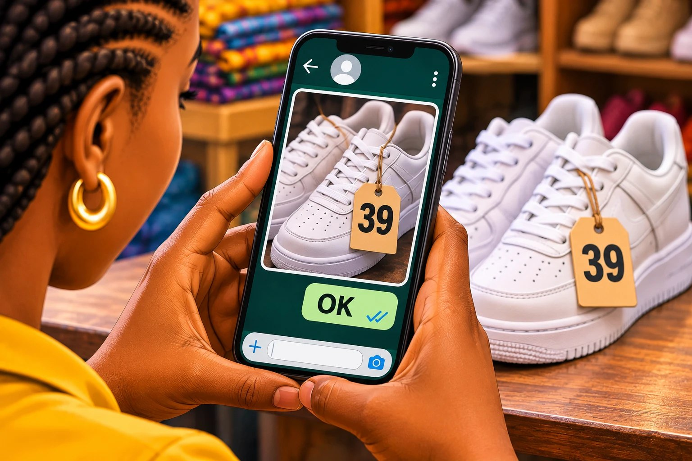

# Chapitre 18 — Commandes annulées et clients fantômes

Le client a dit « oui ». Tu as emballé. Tu as payé le livreur. Le colis roule… et ton téléphone vibre : **« Finalement, c'est annulé. »** C'est peut-être la douleur la plus injuste de la vente.

### 🎬 Exemple 1 — Amina achète exprès… pour rien

Un client veut un sac qu'Amina n'a pas en stock : « Trouve-le-moi, je le prends à 25 000. » Amina va chez son fournisseur, paie 16 000 de sa poche, prend un taxi. **Client :** « Ah, j'ai annulé, j'ai trouvé ailleurs. » Le sac reste dans un coin de sa chambre. Personne d'autre ne l'a demandé.

### 🎬 Exemple 2 — Sékou, en pleine route

Sékou a fait 25 minutes de moto sous le soleil. Il est à 5 minutes de l'adresse. Message de la boutique : « Le client a annulé, reviens. » Le carburant, le temps, une autre course qu'il a refusée pour faire celle-là : tout est perdu.

### 👀 Tu as remarqué ?

**La vente avait l'air faite.** Le vendeur et le livreur ont donc **commencé à dépenser**. Le client, lui, n'a **rien perdu** en annulant : il n'avait rien payé, rien signé. **Tout le risque était du côté du vendeur et du livreur.** Ce chapitre t'apprend à **partager ce risque**, clairement, et dès le début.

## 1. Tu n'es pas seul

Une entreprise qui aide les commerçants en ligne décrit des clients qui « se présentent seulement pour refuser le produit, avec des plaintes comme "la couleur n'est pas bonne" ou "je l'ai vu moins cher en ligne" », en citant parfois des prix faux, dix fois plus bas que le vrai prix.
— article de presse économique, Afrique de l'Ouest (traduit de l'anglais)

Même les grandes entreprises en souffrent. **Jumia**, le grand site de vente en ligne africain, indique dans son rapport annuel 2025 qu'environ **une commande payable à la livraison sur quatre (25 %) échoue**. Et Jumia a des équipes et des entrepôts. Imagine pour un petit vendeur seul avec son téléphone.

> **Les annulations ne sont pas ta faute. Mais c'est ton travail de t'en protéger.** Personne d'autre ne le fera pour toi.

## 2. Ce que te coûte vraiment une annulation

« Je n'ai rien perdu, j'ai toujours le produit. » **C'est faux.** Le calcul d'Amina pour le sac acheté exprès :

| Ce qu'Amina a dépensé | Montant |
|---|---|
| Le sac, payé au fournisseur | 16 000 F |
| Le taxi aller-retour | 2 000 F |
| L'emballage | 300 F |
| Le livreur, aller et retour | 3 500 F |
| **Argent sorti de sa poche** | **21 800 F** |

Elle a **perdu 5 800 F pour toujours** (taxi, emballage, livreur), **16 000 F sont bloqués** dans un sac que personne n'a demandé, et elle a perdu une demi-journée. Si elle envoie 20 colis par semaine et que 5 sont annulés, à 3 500 F de frais chacun, c'est **17 500 F perdus par semaine**, environ **70 000 F par mois**. Ça peut manger tout son bénéfice.

## 3. Pourquoi les clients annulent : les 8 raisons

| # | La raison | Rideau ou mur ? | Ce qui s'est passé avant |
|---|---|---|---|
| 1 | **Il a dit oui trop vite** | Rideau | Coup de cœur, puis réflexion à froid. |
| 2 | **Pas l'argent le jour J** | Mur | La paie n'est pas tombée, une urgence est arrivée. |
| 3 | **Quelqu'un à la maison a dit non** | Mur | Le mari, le parent qui paie (chapitre 15). |
| 4 | **Il a trouvé moins cher** (ou le croit) | Souvent rideau | Il a continué à chercher après ton « oui ». |
| 5 | **Il a peur au dernier moment** | Rideau | Peur que ce ne soit pas conforme, peur de l'arnaque. |
| 6 | **Le délai était trop long** | Mur ou rideau | L'envie est retombée. |
| 7 | **Le produit reçu ne correspond pas** | Mur, et c'est **ta** responsabilité | Photo trompeuse, mauvaise taille ou couleur. |
| 8 | **Il n'a jamais voulu acheter** | Ni l'un ni l'autre | Le « plaisantin », ou le faux client qui prépare une arnaque (section 7). |

Regarde la raison n° 7 : parfois, **c'est le vendeur qui provoque l'annulation**.

« J'ai reçu des cosmétiques périmés, un faux parfum vendu au prix du vrai, un miroir complètement différent de ce que j'avais commandé, etc. J'ai pu refuser la plupart de ces articles. »
— une cliente qui défend le paiement à la livraison, Afrique de l'Ouest (traduit de l'anglais)

Pour cette cliente, pouvoir refuser à la porte est **une protection**. Ton travail n'est donc pas de supprimer ce droit, mais de faire en sorte que le client n'ait **aucune bonne raison** de refuser.

## 4. Le protocole anti-annulation : 7 points AVANT d'envoyer

C'est le cœur du chapitre, et la clé **U** au moment le plus fragile : **un « oui » n'est pas fini tant qu'il n'est pas confirmé.**

**Point 1 — Le récapitulatif écrit, avec « OK ».** Dès le « oui » :

> 📝 **Récapitulatif de votre commande**
> • Article : baskets blanches, pointure **39** (vidéo jointe)
> • Prix : **25 000 F**, livraison comprise
> • Livraison : **demain jeudi, entre 14 h et 16 h**
> • Adresse : ……… · Personne qui reçoit : ……… · Numéro : ………
> • Paiement : à la réception, en espèces ou mobile money
> • Échange possible sous 3 jours si la taille ne va pas
>
> **Merci de répondre « OK » pour confirmer. Sans confirmation, le colis ne part pas.** 🙏

Le client **écrit lui-même** son accord : c'est la cohérence du chapitre 10. Et s'il hésite, c'est **maintenant** qu'il le dira, pas devant la porte.

**Point 2 — La vidéo de l'article exact**, avant d'emballer : couleur, taille visible sur l'étiquette, état. « Voici exactement ce que vous allez recevoir. » À la porte, il ne pourra plus dire honnêtement « ce n'est pas la couleur ».

<figure class="ill"></figure>

**Point 3 — L'appel juste avant le départ.** « Bonjour Madame, c'est Amina pour vos baskets. Le livreur part dans une heure, il sera chez vous vers 15 h. Vous serez bien là ? » **Pas de réponse à l'appel ni au message : le colis ne part pas.**

**Point 4 — Heure, lieu, personne, numéro de secours.** Un créneau de 2 heures, un repère précis, le nom de la personne qui reçoit, et un deuxième numéro.

**Point 5 — Un engagement honnête.** Le point le plus efficace, et le plus délicat :

| Formule | Comment la présenter | Pour qui |
|---|---|---|
| **Frais de livraison payés d'avance** | « La livraison (2 000 F) se paie à la commande, le reste à la réception. » | Nouveaux clients, livraisons loin. |
| **Acompte** | « Pour les articles commandés spécialement pour vous, je demande 30 % à la commande. » | Achats exprès, sur mesure, gros montants. |

Une cliente qui défend pourtant le paiement à la livraison le propose elle-même : « Une suggestion valable serait d'introduire des frais d'engagement. Tu perds une somme payée d'avance si tu refuses la livraison d'un article commandé sans raison. » **Trois règles pour que ce soit honnête :**
1. l'annoncer **avant**, dans le récapitulatif ;
2. **rembourser** si c'est **toi** qui as tort (mauvais article, gros retard) ;
3. **garder** l'acompte seulement si le client annule sans bonne raison.

Tu perdras quelques clients qui refusent de payer quoi que ce soit d'avance : ce sont souvent… ceux qui allaient annuler.

**Point 6 — Ne jamais acheter « exprès » sans acompte.** **Si tu dois sortir ton argent pour aller chercher l'article, le client sort une partie du sien d'abord.** « Comme je l'achète spécialement pour vous, je demande 30 % d'acompte. Je vous envoie la vidéo dès que je l'ai. »

**Point 7 — La liste des annuleurs.** Numéro, date, ce qui s'est passé. Deux annulations sans raison ? La prochaine fois : paiement complet avant l'envoi. Ce n'est pas de la vengeance, c'est de la prudence. Et poliment : « Toutes mes excuses, je ne suis pas disponible pour prendre votre commande. »

### 🎯 À toi de jouer

Une nouvelle cliente écrit : « Je veux 3 sacs, envoie-les aujourd'hui, je paie à la livraison. » Elle refuse de donner un deuxième numéro et ne répond pas quand Amina appelle. **Que fait Amina ?**

- **A.** Elle envoie quand même : 3 sacs, c'est une belle vente.
- **B.** « Avec plaisir ! Pour les nouvelles clientes et les grosses commandes, la livraison (2 000 F) se paie à la commande, le reste à la réception. Je vous envoie le récapitulatif et la vidéo des 3 sacs. Dès que vous confirmez par "OK" et que la livraison est réglée, le colis part. »
- **C.** Elle la bloque : « Toi tu es une arnaqueuse. »

### ✅ La bonne réponse : B

Amina **reste aimable** et garde la vente possible, mais elle **partage le risque**. Si la cliente est sérieuse, elle accepte. Si elle refuse tout, Amina a évité une perte probable, sans accuser personne.

**❌ Pourquoi pas A ?** Grosse commande, nouvelle cliente, pas de deuxième numéro, pas de réponse : plusieurs **signaux d'alerte** à la fois.

**❌ Pourquoi pas C ?** Aucune preuve d'arnaque. L'insulte peut finir en capture d'écran qui circule.

**👉 La bonne action :** ni « tout accepter », ni « tout refuser » : **« oui, avec des règles claires »**.

## 5. Les règles entre vendeur et livreur

Beaucoup de disputes viennent d'une seule chose : **les règles n'ont jamais été dites.** Mettez-vous d'accord **avant**, et écrivez-le.

| Question | Règle conseillée |
|---|---|
| **Qui appelle le client ?** | Le vendeur avant le départ, puis le livreur 10 minutes avant d'arriver. |
| **Combien de temps attendre ?** | Un temps fixé, par exemple 10 à 15 minutes, avec 2 appels et 1 message. Après, retour. |
| **Qui paie la course annulée ?** | À décider ensemble. Souvent, le vendeur paie au moins une partie de l'aller, et récupère ce coût avec l'acompte ou les frais de livraison payés d'avance. Le livreur ne doit pas porter seul tout le risque. |
| **Refus à la porte ?** | Le livreur ne discute pas le prix. Il appelle le vendeur **devant le client**. |
| **Laisser le colis sans paiement ?** | **Jamais**, sauf accord écrit du vendeur (chapitre 17). |
| **Vérifier un paiement mobile ?** | Sur **le téléphone du vendeur**, jamais sur une capture du client. |

Le livreur, c'est **le dernier vendeur** (chapitre 25). Un vendeur qui le paie correctement et lui donne des informations claires perd beaucoup moins de ventes à la porte.

## 6. Quand l'annulation arrive quand même

Ton objectif : **sauver la vente** si possible (souvent c'est un rideau) ; sinon, **sauver la relation** et **limiter la perte**. La règle : **calme, une question, une porte. Jamais d'insulte.**

| Ce qui arrive | Ce que tu dis |
|---|---|
| **« J'annule » après l'emballage** | « D'accord, merci de me prévenir avant le départ. Juste pour comprendre : c'est le modèle, le prix ou le moment qui ne va plus ? » |
| **Annulé en pleine route** | Au client : « Le livreur est à 5 minutes de chez vous. Vous voulez au moins voir l'article ? S'il ne vous plaît pas, il repart, sans obligation. » Souvent, le client accepte de regarder… et achète. |
| **« Pas l'argent aujourd'hui, repasse demain »** (livreur) | « Pas de souci, ça arrive. Pour ne pas refaire la route pour rien : demain à quelle heure exactement ? Et pour que la boutique vous garde l'article, vous pouvez régler la livraison maintenant par mobile money. Je l'appelle avec vous ? » |
| **Injoignable au rendez-vous** | Un message calme : « Le livreur est arrivé à 15 h au lieu convenu. Il a appelé deux fois. Il repart à 15 h 15. Pour une nouvelle livraison, les frais seront à régler d'avance. Bonne journée. » |
| **« Ce n'est pas la couleur »** (livreur) | « La boutique vous avait envoyé la vidéo hier, c'est le même article. On l'appelle ensemble pour voir ce qui ne va pas ? » |
| **L'annulation est définitive** | « Très bien, merci de m'avoir prévenu. Si un jour vous en avez besoin, je serai là. » Et tu notes le numéro, calmement. |

## 7. Les faux clients et les arnaques

Certains n'ont **jamais voulu acheter** : ils s'amusent, ou préparent une arnaque (faux paiement, colis récupéré sans payer). **Aucun signal seul ne prouve une arnaque**, mais **plusieurs ensemble** doivent activer tes règles :
- une grosse commande d'un inconnu, sans aucune question sur le produit ;
- un client qui refuse les appels et répond seulement par écrit ;
- une adresse vague, ou qui change au dernier moment ;
- un colis à remettre à **quelqu'un d'autre** qui paiera « plus tard » ;
- une **capture d'écran** de paiement au lieu d'un vrai paiement ;
- un lieu isolé, la nuit.

« Porter plainte devient compliqué faute de preuve, puisque le client peut dire qu'il t'a envoyé l'argent par erreur et qu'il ne t'a rien acheté. »
— un commerçant, à propos des faux paiements par mobile money, Afrique de l'Est (traduit de l'anglais)

**La règle d'or :** le paiement est vérifié **sur le téléphone du vendeur**, par **le message officiel de l'opérateur**, et le solde est vérifié. **Et la sécurité du livreur passe avant la vente** : si un lieu le met mal à l'aise, il n'y va pas, ou il demande un endroit fréquenté. Le vendeur doit le soutenir.

## 8. Transformer une annulation en vente plus tard

Souvent, une annulation est un **« pas maintenant »**. Sors proprement, sans reproche. Pose **une seule** question (« Qu'est-ce qui vous a fait changer d'avis ? ») pour t'améliorer. **Revends vite l'article revenu**, grâce à une **liste d'attente** des clients qui avaient demandé un article en rupture. Si c'était un mur d'argent, **recontacte au moment où l'argent arrive** (chapitre 13). Mais deux annulations sans raison : paiement d'avance obligatoire, poliment.

### 👥 Dans ta situation

| Profil | Ta protection |
|---|---|
| **A — Fanta** | Chez elle, l'annulation, c'est la robe **mise de côté** ou **retouchée** pour une cliente qui ne revient pas : date limite (chapitre 16) et **acompte avant toute retouche**. |
| **B — Amina** | Les **7 points** du protocole, en commençant par le récapitulatif « OK » et la vidéo de l'article exact. Frais de livraison d'avance pour les nouveaux clients, acompte de 30 % pour tout achat exprès. |
| **C — Ibrahima** | Le client qui **réserve sa place** puis disparaît, ou qui **abandonne au paiement** : récapitulatif clair, rappel le jour même avec un lien simple, et son aide s'il bloque. |
| **D — Koffi** | Le **bon de commande signé puis annulé** : conditions d'annulation écrites, et acompte pour les commandes spéciales. |
| **E — Sékou** | Il appelle **10 minutes avant**, respecte le temps d'attente, ne discute jamais le prix, ne laisse rien sans paiement vérifié. Et **sa sécurité avant tout**. |

### ✍️ Entraîne-toi

**1.** Écris **ton propre récapitulatif de commande** (article, prix total, date et heure, adresse, numéro de secours, paiement, échange, « répondez OK »).

**2. Vendeur et livreur :** écrivez ensemble vos 5 règles (appel avant départ, temps d'attente, qui paie la course annulée, paiement à vérifier, refus à la porte).

### 📖 Les mots à connaître

| Mot | En simple | En pro |
|---|---|---|
| **Récapitulatif de commande** | Le message qui résume tout ce qui a été convenu. | Confirmation de commande écrite. |
| **Frais d'engagement** | Une petite somme payée d'avance, qui montre que le client est sérieux. | Acompte, *commitment fee*. |
| **Liste d'attente** | Les clients qui attendent un article qui n'est pas en stock. | Précommandes. |
| **Annulation** | Le client dit qu'il ne veut plus, après avoir dit oui. | Rétractation ou annulation de commande avant paiement. |
| **Paiement à la livraison** | Le client paie quand il reçoit le colis. | *Cash on delivery* (COD). |
| **Liste des annuleurs** | La liste des numéros qui ont déjà annulé sans raison. | Historique de fiabilité client. |

### ✅ À retenir

- ☐ Je connais le vrai coût d'une annulation.
- ☐ Récapitulatif écrit avec « OK », vidéo de l'article exact, appel avant le départ : sinon, le colis ne part pas.
- ☐ Frais de livraison d'avance ou acompte quand c'est justifié, annoncés dès le début, et jamais d'achat exprès sans acompte.
- ☐ J'ai écrit mes règles avec mon livreur, et je vérifie les paiements sur mon téléphone.
- ☐ Quand ça arrive : calme, une question, une porte. Jamais d'insulte.

⚠️ **L'erreur à éviter :** envoyer le colis sur un simple « oui, emballe ». Tant qu'il n'y a pas de récapitulatif confirmé, d'heure fixée et de numéro qu'on peut appeler, le colis ne part pas.

➡️ **Et maintenant ?** Fin de la partie 3. La **partie 4** adapte tout à **ta façon de vendre** : le marché, WhatsApp, le digital, le téléphone, les entreprises, la diaspora et la livraison.

