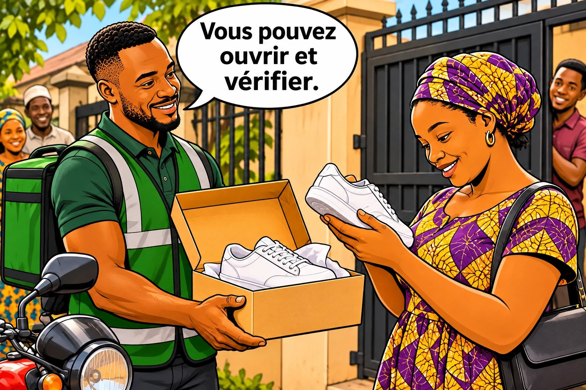

# Chapitre 25 — Le livreur, dernier closer

Le vendeur a tout bien fait. Le client a dit « oui ». Le colis est emballé. Il ne reste qu'une chose : **la minute où le livreur sonne à la porte.** Et c'est souvent là que tout s'écroule.

### 🎬 Exemple 1 — « Repasse demain »

Le client descend, regarde le colis, puis dit : « Ah, je n'ai pas encore l'argent aujourd'hui. Repasse demain. » Sékou proteste : « Mais vous avez confirmé ce matin ! » Le ton monte. Le client remonte chez lui en claquant la porte.

### 🎬 Exemple 2 — « Donne le colis à mon assistant »

Le client appelle Sékou : « Je suis en réunion. Remets le colis à mon assistant, je fais le transfert tout de suite. » Sékou remet le colis. Le transfert n'arrive jamais. Le client ne répond plus.

### 👀 Tu as remarqué ?

La vente était **presque finie** : produit choisi, prix accepté, colis en route. Tout s'est écroulé **à la dernière étape**. Et **personne n'avait prévu** quoi faire dans ces situations. Le livreur n'est pas seulement un transporteur : **c'est le dernier vendeur**, celui qui transforme le « oui » en argent. Ce chapitre est pour lui, et pour les vendeurs qui travaillent avec lui.

## 1. Le livreur, le dernier vendeur

En ligne, l'étape 6 de la vente (chapitre 1), « il dit oui et il paie », est **coupée en deux** : le « oui », le vendeur l'obtient par message ; le « paie », **le livreur** l'obtient à la porte. Entre les deux, le client a eu le temps de comparer, d'en parler, ou d'avoir moins d'argent. Le livreur entend donc des **objections**, exactement comme un vendeur.

Tu as vu au chapitre 18 qu'environ une commande payable à la livraison sur quatre échoue chez Jumia. Chaque course perdue coûte : le carburant, le temps du livreur (d'autres livraisons ratées), l'emballage, parfois un produit abîmé, et un article bloqué qu'un autre client aurait acheté. Souvent **plus que le bénéfice** de la vente. **La meilleure façon de gagner une vente à la porte, c'est de la préparer avant de partir.**

## 2. Avant de partir : la règle des 4 « OK »

Le chapitre 18 explique comment le vendeur confirme la commande. Côté livreur : **pas de départ sans 4 « OK »**.

| OK | La vérification | Comment |
|---|---|---|
| **1. Produit** | Exactement ce qui a été commandé (taille, couleur, quantité). | Comparer avec le **récapitulatif** (chapitre 20), photo du contenu avant de fermer. |
| **2. Client** | Joignable, disponible, il attend le colis **maintenant**. | **Appel** juste avant le départ. Pas de réponse = pas de départ. |
| **3. Adresse** | L'adresse et un **repère** précis. | « Vous êtes près de quoi ? Une pharmacie, une école, une mosquée, une église ? » |
| **4. Montant** | Il connaît le **total** et a l'argent prêt. | « Ce sera 20 000 F, livraison comprise. Espèces ou mobile money ? » |

> « Bonjour Madame, c'est Sékou, le livreur de la boutique d'Amina. Je vous apporte vos chaussures noires en 39. **Ce sera 20 000 F en tout.** Vous êtes toujours disponible ? Je peux être là dans 30 minutes. Vous êtes à quel repère exactement ? Vous payez en espèces ou en mobile money ? »

Ce n'est **pas** un interrogatoire, c'est de l'organisation. Le **montant redit** évite « je ne savais pas que c'était ce prix » ; le **moyen de paiement** évite « je n'ai pas la monnaie » ; le **« vous êtes disponible »** évite le client absent.

### 🎯 À toi de jouer

Avant de partir, Sékou appelle une cliente. Elle répond : « Euh… oui, oui, venez. Mais je ne suis pas sûre d'être là à 15 h. » **Que fait Sékou ?**

- **A.** Il part quand même : elle a dit « oui, venez ».
- **B.** « Pas de souci. À quelle heure vous êtes sûre d'être là ? Je passe à ce moment-là, et je vous appelle 10 minutes avant. »
- **C.** Il annule la commande lui-même : elle n'est pas sérieuse.

### ✅ La bonne réponse : B

Sékou a entendu **le doute**. Il fixe avec elle **une heure sûre** : c'est la clé **U — Unir** (chapitre 11) appliquée à la livraison.

**❌ Pourquoi pas A ?** « Je ne suis pas sûre d'être là » est un signal d'alerte : course perdue en vue.

**❌ Pourquoi pas C ?** Ce n'est pas au livreur d'annuler une vente. Elle a un problème d'heure : **un mur avec une porte** (chapitre 4).

**👉 La bonne action :** un « euh… oui » n'est pas un « oui ». Fixe une heure **sûre**.

**En route**, les retards arrivent (embouteillages, pluie, panne). Ce qui fâche le client, c'est **le silence**. Préviens avant l'heure prévue : « Il y a beaucoup d'embouteillages, j'aurai 20 minutes de retard. Désolé. Ça vous va toujours ? » Et appelle 10 minutes avant d'arriver : « Vous pouvez préparer le paiement ? » **Un client prévenu reste patient. Un client oublié devient méfiant.**

## 3. À la porte : les 6 règles du livreur qui encaisse

Pour le client, **tu es la boutique**. Si tu es poli et rassurant, il pense : « Cette boutique est sérieuse. »

<figure class="ill"></figure>
1. **Salue et présente-toi** : « Bonjour Madame, je suis Sékou, le livreur de la boutique d'Amina. Voici vos chaussures. »
2. **Tenue propre, ton calme**, même fatigué, même en retard.
3. **Laisse vérifier** : « Vous pouvez ouvrir et vérifier. » Un client qui vérifie devant toi ne pourra pas dire plus tard que ce n'était pas le bon produit.
4. **Annonce le montant** : « Ce sera 20 000 F, comme convenu. »
5. **Ne discute jamais le prix** : il a été fixé par le vendeur.
6. **Reste poli même si ça se passe mal** : les voisins regardent.

« Imprudente, je n'ai fait aucune vérification en présence du livreur. C'est seulement dans la soirée que je l'ai faite. […] J'ai coulé des larmes. Le commerçant n'a plus pris mes appels, ni mes messages. »
— une cliente arnaquée lors d'un achat en ligne, Afrique de l'Ouest

Depuis, comme beaucoup d'autres, elle veut **tout vérifier devant le livreur**. Pour un livreur honnête, c'est une **bonne nouvelle** : une fois que le client a vérifié et payé, l'affaire est claire pour tout le monde.

## 4. Les 8 situations à la porte, et quoi dire

**Règle d'or : tu restes calme, et tu appelles le vendeur dès que c'est une question de produit ou de prix.**

| La situation | Souvent derrière | Ce que tu dis / fais |
|---|---|---|
| **1. « Je n'ai pas l'argent, repasse demain. »** | Mur d'argent, ou rideau (il a changé d'avis). | « Vous avez une partie aujourd'hui ? » Sinon : « Je rapporte le colis à la boutique. Quand êtes-vous sûr d'avoir l'argent ? Je préviens la vendeuse. » Pas de dispute. |
| **2. « Ce n'est pas la couleur / la taille. »** | Erreur réelle, ou changement d'avis. | « Montrez-moi. » Tu compares avec le **récapitulatif**. Erreur de la boutique : tu appelles le vendeur. Sinon : « C'est bien le modèle commandé, je vous montre le message. Je vous passe la vendeuse ? » |
| **3. « J'ai vu moins cher ailleurs. »** | Hésitation, ou envie de négocier. | « Le prix a été fixé avec la boutique. Je vous passe la vendeuse ? » (Elle répond avec le chapitre 12.) |
| **4. « C'est plus cher que prévu. »** | Frais de livraison mal annoncés. | « C'était 18 000 + 2 000 de livraison, comme dans le message confirmé. » Si le vendeur s'est trompé, tu l'appelles. |
| **5. « Attends, je descends dans 30 minutes. »** | Client occupé, ou qui hésite. | « J'ai d'autres livraisons. Je peux attendre 10 minutes, sinon je repasse plus tard. » (Selon votre accord, section 6.) |
| **6. Ne décroche pas / téléphone éteint.** | Absent, oubli, ou faux client. | Tu attends le temps convenu, tu laisses **un message et un vocal** : « Je suis devant [repère], j'attends 10 minutes. » Puis tu préviens le vendeur et tu repars. |
| **7. « Donne le colis à mon assistant, je fais le transfert. »** | Souvent sincère… parfois un piège. | **Pas de paiement, pas de colis**, sauf accord écrit du vendeur : « Votre assistant peut payer, ou je vous attends. » |
| **8. Le client s'énerve ou insulte.** | Frustration, ou mauvaise foi. | Tu ne réponds pas aux insultes : « Je comprends que vous soyez fâché. J'appelle la boutique pour régler ça. » Si ça devient dangereux, tu pars. |

« He told me to hand over the delivery to his assistant so he could transfer all the money to me. […] I did because I trusted him. I was expecting N75,000 but he did not transfer any money to me. »
(« Il m'a dit de remettre la livraison à son assistant, et qu'il me transférerait tout l'argent. […] Je l'ai fait parce que je lui faisais confiance. J'attendais 75 000 nairas, mais il ne m'a rien transféré. »)
— une vendeuse de chaussures en ligne, Afrique de l'Ouest anglophone (traduit de l'anglais)

Une entreprise qui lutte contre les « annuleurs en série » au Nigeria décrit aussi les clients qui se présentent seulement pour **refuser le produit** (« la couleur n'est pas bonne », « je l'ai vu moins cher en ligne »). Tu n'es pas seul à vivre ça.

### 🎯 À toi de jouer

Une cliente ouvre le colis : « Ce n'est pas le noir que je voulais, il est trop foncé. Reprenez-le. » Sékou vérifie : c'est **exactement** le modèle de la vidéo et du récapitulatif qu'elle a confirmés. **Que fait Sékou ?**

- **A.** Il s'énerve : « Vous avez vu la vidéo ! Vous avez dit OK ! Vous devez payer ! »
- **B.** Calmement : « Je comprends. C'est bien le modèle de la vidéo que vous avez confirmée, je vous la montre. Vous voulez que j'appelle la vendeuse ? »
- **C.** Il repart sans rien dire, avec le colis.

### ✅ La bonne réponse : B

Sékou montre **la preuve** sans accuser, et propose **d'appeler la vendeuse**. Parfois, la cliente paie ; parfois, la vendeuse propose une solution (un échange, des frais de déplacement). Dans tous les cas, pas de dispute.

**❌ Pourquoi pas A ?** Même s'il a raison, crier devant les voisins ne la fera pas payer, et abîme l'image de la boutique.

**❌ Pourquoi pas C ?** Il abandonne une petite hésitation que la vendeuse aurait pu lever en 2 minutes.

**👉 La bonne action :** **ne discute jamais seul** d'un problème de produit ou de prix : montre la preuve et **mets le client en ligne avec le vendeur**.

## 5. Encaisser sans se faire piéger, et rester en sécurité

| Règle | Pourquoi |
|---|---|
| **Le colis contre l'argent, en même temps** | Pas de « je te paie après ». |
| **Vérifier le mobile money sur ton propre téléphone** | Un SMS montré sur le téléphone du client peut être faux. Attends **ton** message, ou la confirmation du vendeur. |
| **Compter les espèces devant le client, et avoir de la monnaie** | « Je n'ai pas la monnaie » est une excuse fréquente pour reporter. |
| **Donner un reçu** | Même un message : « Reçu 20 000 F de Mme X pour la commande 12. » |
| **Jamais de remise à un tiers sans accord écrit du vendeur** | Voir la situation 7. |
| **Verser l'argent au vendeur le jour même** | La confiance se construit sur la régularité. |

« Je n'ai pas besoin d'avoir un magasin. Sur la page Facebook que j'ai créée, je fais des présentations, avec un numéro de téléphone et un numéro WhatsApp. Les clients m'appellent, je sollicite les services d'un livreur, et à la fin de la journée, il fait mon versement. »
— une vendeuse de riz en ligne, Afrique de l'Ouest

**Ta sécurité d'abord. Aucune vente ne la vaut.** Préfère les lieux visibles (devant une boutique, une pharmacie). N'entre pas dans un endroit fermé si tu ne te sens pas en sécurité : le client peut descendre. Partage ta position avec le vendeur ou un collègue. Évite les livraisons de nuit dans des lieux isolés. Ne garde pas trop d'espèces sur toi. **Si ça devient dangereux, pars : un colis se remplace, toi non.**

## 6. L'accord entre le vendeur et le livreur

Beaucoup de disputes viennent d'une seule chose : **rien n'a été décidé à l'avance**.

| Question | Exemple de règle |
|---|---|
| **Quand partir ?** | Après le récapitulatif confirmé **et** l'appel avant départ. |
| **Combien de temps attendre ?** | 10 à 15 minutes maximum, avec message et vocal. |
| **Qui paie une course perdue ?** | Par exemple : le vendeur paie la moitié de la course, même si le client annule. |
| **Si le client conteste ?** | Le livreur appelle le vendeur devant le client. Pas de remise sans accord écrit. |
| **Remettre à un tiers ?** | Jamais sans accord écrit du vendeur. |
| **Quand verser l'argent ?** | Le soir même, avec la liste des livraisons. |
| **Comment communiquer ?** | Un groupe WhatsApp vendeur-livreur, avec chaque récapitulatif. |

Les **frais d'engagement** et la **liste des annuleurs** sont expliqués au chapitre 18. Côté livreur, une seule règle en plus : cette liste reste **entre partenaires**. Jamais publiée, jamais de photos ni d'humiliation publique.

### 🎯 À toi de jouer

Amina et Sékou travaillent ensemble depuis un mois. Ils se disputent souvent pour les courses annulées. **Quelle est la meilleure solution ?**

- **A.** Sékou refuse désormais toutes les livraisons payées à la livraison.
- **B.** Ils écrivent ensemble leurs règles en 30 minutes : départ après récapitulatif et appel, 15 minutes d'attente maximum, moitié de la course payée par Amina en cas d'annulation, versement chaque soir.
- **C.** Ils règlent les disputes au cas par cas.

### ✅ La bonne réponse : B

Ils **fixent les règles avant les problèmes**. Chacun sait ce qu'il doit faire et ce qu'il risque. Les disputes diminuent et ils perdent moins d'argent tous les deux.

**❌ Pourquoi pas A ?** Le paiement à la livraison rassure les clients (chapitre 14). Le supprimer, c'est perdre beaucoup de ventes.

**❌ Pourquoi pas C ?** Sans règles, chaque annulation devient une dispute. Un jour, Sékou ira travailler ailleurs.

**👉 La bonne action :** écrivez **votre accord en une page**, et mettez-le dans votre groupe WhatsApp.

**Un mot pour les vendeurs.** Ton livreur **représente ta boutique** devant chaque client, porte ton argent et prend des risques sur la route. Paie-le à l'heure, donne-lui toutes les informations, réponds-lui vite quand il t'appelle depuis une porte, et ne lui fais pas porter tes erreurs. Un livreur respecté, c'est **un vendeur de plus** dans ton équipe.

### 👥 Dans ta situation

| Profil | Ce chapitre pour toi |
|---|---|
| **E — Sékou** | C'est ton chapitre. Dès demain : les 4 « OK », le colis contre l'argent, jamais à un tiers sans accord écrit, et un accord avec chaque boutique. |
| **B — Amina** | Ton livreur est ton dernier vendeur : envoie-lui chaque récapitulatif, réponds-lui vite, fixe l'accord de la section 6. |
| **C — Ibrahima** | Ton « moment de la porte », c'est l'**accès** envoyé tout de suite après le paiement (chapitre 21). |
| **D — Koffi** | En entreprise : le nom de la personne qui réceptionne et un **bon de livraison** signé. |
| **A — Fanta** | Si tu commences à livrer, commence avec les clientes qui ont déjà acheté chez toi. |

### ✍️ Entraîne-toi

**1.** Écris ton appel avant départ complet (présentation, produit, montant, disponibilité, repère, paiement).

**2. L'accord vendeur-livreur.** Je pars seulement si… J'attends au maximum… Si le client annule, la course est payée par… Je verse l'argent…

**3. Jeu de rôle à la porte.** Un proche joue le client et choisit au hasard une des 8 situations. Tu réponds **calmement**, et tu « appelles le vendeur » quand c'est nécessaire. Faites les 8.

### 📖 Les mots à connaître

| Mot | En simple | En pro |
|---|---|---|
| **Paiement à la livraison** | Le client paie quand il reçoit le colis. | *Cash on delivery* (COD). |
| **Course perdue** | Une livraison où le client ne prend pas le colis. | Échec de livraison. |
| **Versement** | L'argent encaissé que le livreur rend au vendeur. | Reversement des encaissements. |
| **Bon de livraison** | Le papier signé qui prouve que le colis a été remis. | Preuve de livraison. |
| **Repère** | Un endroit connu près de l'adresse. | Point de repère. |
| **Frais d'engagement** | Une petite somme payée d'avance, perdue si le client refuse sans raison. | *Commitment fee*, acompte non remboursable. |

### ✅ À retenir

- ☐ Avant chaque départ : OK produit, OK client, OK adresse, OK montant.
- ☐ Je préviens avant chaque retard, et j'appelle 10 minutes avant d'arriver.
- ☐ À la porte : je salue, je laisse vérifier, j'annonce le montant, je reste calme.
- ☐ Je ne négocie jamais seul : j'appelle le vendeur devant le client.
- ☐ Le colis contre l'argent, mobile money vérifié sur mon téléphone, jamais à un tiers sans accord écrit.
- ☐ Ma sécurité passe avant la vente, et j'ai un accord écrit avec chaque boutique.

⚠️ **L'erreur à éviter :** partir **sans avoir appelé le client**, parce qu'il a dit « oui » la veille. Entre hier et aujourd'hui, il a pu changer d'avis, de lieu, ou dépenser son argent. **Pas d'appel, pas de départ.**

➡️ **Et maintenant ?** La **partie 5** transforme les techniques en **habitudes**. Le chapitre 26 t'apprend à construire **ta boîte à histoires** : une histoire vraie pour chaque peur de tes clients.

